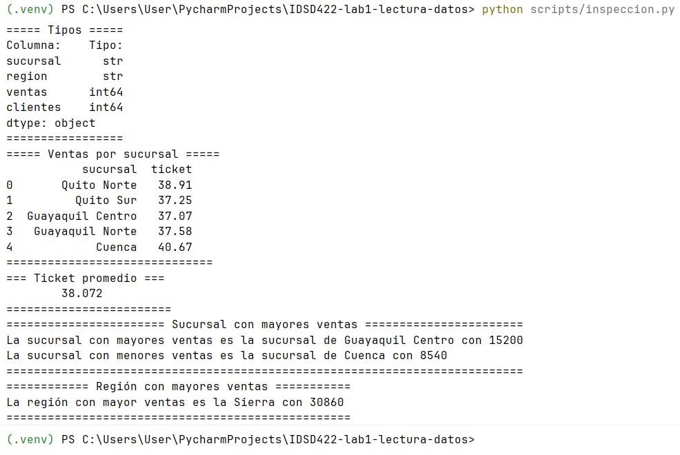
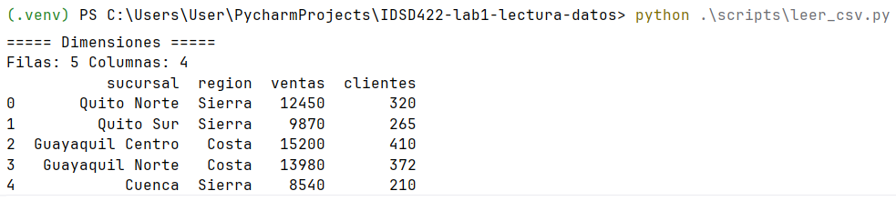
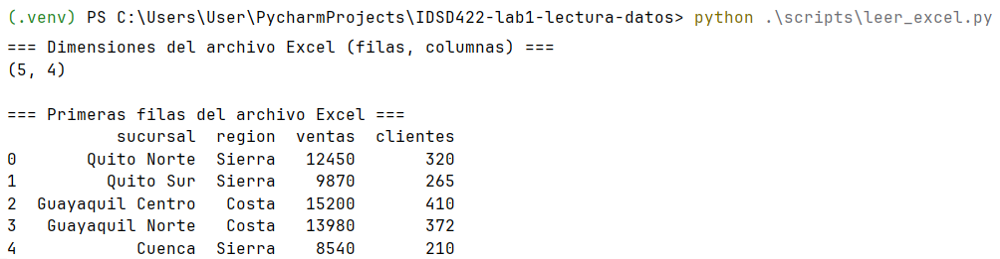
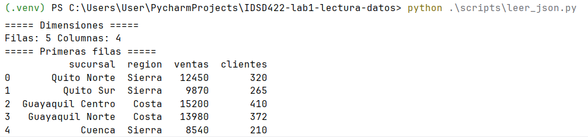
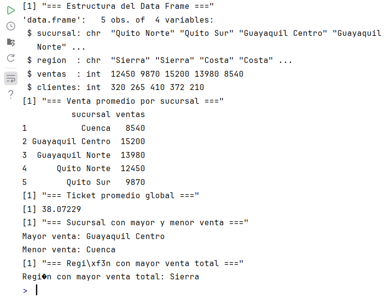
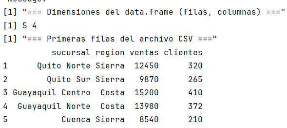
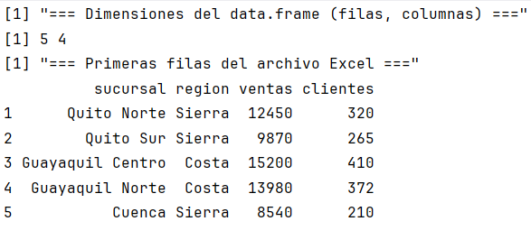
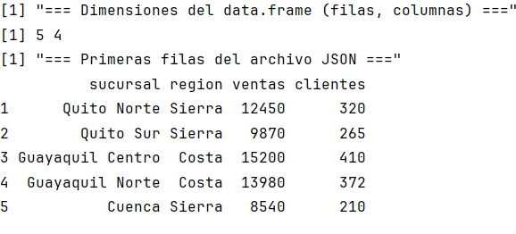

<!-- CARÁTULA UNIFORMADA EPN (PÁGINA ÚNICA) -->
<div style="font-family: 'Segoe UI', Arial, sans-serif; text-align: center; max-width: 750px; margin: 0 auto; padding: 40px 20px; color: #555555; page-break-after: always; break-after: page;">

  <!-- ENCABEZADO INSTITUCIONAL -->
  <h2 style="color: #1b2a47; font-size: 1.4em; font-weight: 800; letter-spacing: 2px; margin-bottom: 6px; text-transform: uppercase;">
    ESCUELA POLITÉCNICA NACIONAL
  </h2>
  <p style="color: #555555; font-size: 0.95em; margin-top: 0; margin-bottom: 25px;">
    Facultad de Ingeniería de Sistemas &middot; Carrera de Ciencia de Datos e Inteligencia Artificial
  </p>

  <!-- LÍNEA DECORATIVA DORADA -->
  <div style="width: 60px; height: 3px; background-color: #b5984d; margin: 0 auto 30px auto; border-radius: 2px;"></div>

  <!-- TÍTULO DE LA PRÁCTICA -->
  <p style="color: #b5984d; font-weight: 700; font-size: 0.9em; letter-spacing: 1.5px; text-transform: uppercase; margin-bottom: 10px;">
    INFORME DE PRÁCTICA N.&deg; 1
  </p>
  <h1 style="color: #1b2a47; font-size: 2.1em; font-weight: 800; margin-top: 0; margin-bottom: 12px;">
    Consolidación de reportes de ventas (CSV, JSON y Excel)
  </h1>
  <p style="color: #555555; font-size: 0.92em; margin-top: 0; margin-bottom: 45px;">
    Tópico del PEA &middot; Asignatura IDSD422 &mdash; Estadística y Programación para Ciencia de Datos I
  </p>

  <!-- TABLA DE DATOS -->
  <table style="width: 100%; border-collapse: collapse; margin: 0 auto; text-align: left; font-size: 0.9em; border: 1px solid #dcdfe6;">
    <tbody>
      <tr style="border-bottom: 1px solid #dcdfe6;">
        <th style="background-color: #f4f6f8; color: #1b2a47; width: 32%; padding: 12px 16px; font-weight: 700;">Estudiante(s)</th>
        <td style="padding: 12px 16px; color: #333333;">Lamiña Flores, Matías Andres &mdash; usuario de GitHub: <a href="https://github.com/matiasLam67" target="_blank" style="color: #0366d6; text-decoration: none;">https://github.com/matiasLam67</a></td>
      </tr>
      <tr style="border-bottom: 1px solid #dcdfe6;">
        <th style="background-color: #f4f6f8; color: #1b2a47; padding: 12px 16px; font-weight: 700;">Docente</th>
        <td style="padding: 12px 16px; color: #333333;">SUAREZ COBOS CHRISTIAN GONZALO</td>
      </tr>
      <tr style="border-bottom: 1px solid #dcdfe6;">
        <th style="background-color: #f4f6f8; color: #1b2a47; padding: 12px 16px; font-weight: 700;">Período académico</th>
        <td style="padding: 12px 16px; color: #333333;">2026-B</td>
      </tr>
      <tr style="border-bottom: 1px solid #dcdfe6;">
        <th style="background-color: #f4f6f8; color: #1b2a47; padding: 12px 16px; font-weight: 700;">Fecha de entrega</th>
        <td style="padding: 12px 16px; color: #333333;">19/10/2026</td>
      </tr>
      <tr>
        <th style="background-color: #f4f6f8; color: #1b2a47; padding: 12px 16px; font-weight: 700;">Repositorio (fork)</th>
        <td style="padding: 12px 16px; color: #333333;"><a href="https://github.com/matiasLam67/IDSD422-lab1-lectura-datos.git" target="_blank" style="color: #0366d6; text-decoration: none;">https://github.com/matiasLam67/IDSD422-lab1-lectura-datos.git</a></td>
      </tr>
    </tbody>
  </table>

</div>
<!-- FIN DE CARÁTULA -->
---

## 1. Introducción
RetailAndina S.A. recibe el reporte semanal de ventas en tres formatos 
distintos porque provienen de tres sistemas independientes. 
El equipo de BI debe confirmar que los tres contienen la misma información 
y describir su estructura junto con información estadística relevante antes
de la reunión de gerencia.

---

## 2. Objetivos
Analizar un mismo reporte de ventas disponible en CSV, JSON y Excel. 
Específicos: (1) leer los tres archivos en Python y en R; (2) verificar 
dimensiones y tipos de cada columna; (3) comunicar información estadística 
básica; (4) reportar las diferencias entre formato.

---

## 3. Desarrollo de la práctica
### 3.1. ¿Cuántas filas y columnas tiene la tabla en cada uno de los tres formatos?
Los tres formatos contienen la misma información estructurada en 5 filas y 
4 columnas. En los formatos tabulares (CSV y XLSX), esta disposición es 
directa y nativa a través de celdas organizadas en filas y columnas. 
Por su parte, en el formato JSON, esta misma estructura tabular se 
representa como una lista de 5 objetos (equivalentes a las filas), 
donde cada uno contiene 4 atributos o claves (equivalentes a las columnas).
### 3.2. ¿Qué tipo de datos se infirió para ventas y clientes? ¿Qué indicaría que salieran como texto?
Son:
+ `ventas` se infirió como `int64` en python, mientras que en R su tipo fue `int`.
+ `clientes` por otro lado, fue `str` en python, y `chr` en R.  

Si la función `dtypes` de pandas nos devuelve `str` o `chr` con la función `str` de R significaria que los datos no han sido limpiados correctamente y se encuentra algún valor no numérico en `ventas`

**Tipos de datos en python:**
```text
===== Tipos =====
Columna:    Tipo:
sucursal      str
region        str
ventas      int64
clientes    int64
dtype: object
=================
```
**Tipos de datos en R:**

``` text
> str(df)
[1] "=== Estructura del Data Frame ==="
'data.frame':	5 obs. of  4 variables:
 $ sucursal: chr  "Quito Norte" "Quito Sur" "Guayaquil Centro" "Guayaquil Norte" ...
 $ region  : chr  "Sierra" "Sierra" "Costa" "Costa" ...
 $ ventas  : int  12450 9870 15200 13980 8540
 $ clientes: int  320 265 410 372 210
 >
```

### 3.3. En Python, ¿qué estructura devuelve json.load y por qué hay que "aplanarla"?
`json.load()` devuelve una estructura de datos nativa de Python, 
transformando un objeto JSON {} en un diccionario (`dict`) y 
una matriz JSON [] en una lista (`list`).

Es necesario "aplanar" esta estructura cuando se requiere analizar 
o exportar los datos en formato tabular. Esto se debe a que el estándar 
JSON permite anidar objetos y listas a múltiples niveles de profundidad, 
una estructura jerárquica bidimensional que no se alinea de forma nativa 
con el esquema rígido de filas y columnas de una tabla. 
Al aplanar el JSON, los niveles anidados se convierten en columnas 
independientes de un solo nivel.
### 3.4. ¿Para qué sirve indicar sheet_name/sheet al leer Excel?

Excel permite que un archivo tenga varias hojas, pero en Python/pandas 
solo se puede leer una, esto obliga a la funcion `pd.read_excel` necesitar 
del parametro `sheet_name` para elegir qué hoja leer del archivo.
```python
import pandas as pd
df = pd.read_excel("data/ventas.xlsx", sheet_name="ventas")
```
### 3.5. ¿Qué diferencia ves entre leer en Python y leer en R (conceptos, no sintaxis)?

La principal diferencia conceptual radica en la filosofía de diseño de 
cada lenguaje y cómo entienden las estructuras de datos de forma nativa: 

**R** fue creado específicamente para el **_análisis estadístico_**, por lo que el
concepto de tabla o DataFrame viene integrado en el núcleo del lenguaje 
desde su instalación básica; al leer un archivo, R asume de inmediato que 
trabaja con una estructura bidimensional de filas y columnas con propiedades 
estadísticas. 

En contraste, **Python** es un lenguaje de ***propósito general*** cuyo 
núcleo procesa archivos mediante estructuras de programación puras y 
genéricas, como listas o diccionarios. Por esta razón, Python no entiende 
conceptualmente lo que es una tabla de datos hasta que se importa una 
librería externa especializada, como Pandas, la cual actúa como un puente 
para transformar esas estructuras primitivas en un formato tabular.
---

## 4. ¿Qué aprendí con esta práctica?

Al finalizar este laboratorio, logré consolidar el flujo completo de ingesta
y lectura de datos heterogéneos provenientes de formatos `.csv`, `.xlsx` y
`.json`, estructurados dentro de arquitecturas de proyectos 
profesionales. A lo largo del proceso, comprendí la importancia 
crítica de manejar rutas relativas y absolutas 
en Python y las funciones nativas en R (pues no había usado este lenguaje en absoluto), 
lo que garantiza que el 
proyecto sea 100% portable y ejecutable desde la raíz en cualquier 
sistema operativo. Asimismo, aprendí a gestionar correctamente los 
entornos virtuales en PyCharm, resolviendo conflictos de 
dependencias como la falta del motor de lectura de hojas de cálculo
(`openpyxl`) e independizando la ejecución de scripts en R
para evitar bloqueos por repositorios CRAN.

El mayor desafío técnico radicó en la gestión de la ejecución de 
scripts de R. Inicialmente el plugin de R oficial de JetBrains no reconocía mi versión del lenguaje R instalado,
provocando errores fatales al momento de intentar correr el código o abrir la terminal. 
Superé este inconveniente desinstalando la versión de R que tenía descargada, e instalando una 
versíon estable y más antigua desde la terminal, de esta forma el plugin reconoció el lenguaje y 
logré ejecutar lenguaje R directamente en el IDE(PyCharm). 


Si tuviera que reiniciar el proyecto, desde el primer momento 
implementaría la instalación de R y el plugin de R, asi como las librerias necesarias para la ejecución de scripts 
de R. Me centraría en realizar el informe junto con la ejecución y no dejarlo hasta el final del laboratorio. 

---
## 5. Conclusiones

**1.** **Invarianza y consistencia en la ingesta multiformato:** Los tres 
formatos analizados (`.csv`, `.json` y `.xlsx`) contienen exactamente la 
misma estructura y volumen de información tanto en Python (Pandas) 
como en R Base, registrando 5 filas y 4 variables columnas (`sucursal`, `region`, `ventas`, `clientes`). Asimismo, la 
inferencia de tipos de datos fue 100% consistente en ambos entornos, 
mapeando sucursal y region como cadenas de texto (`str` / `chr`) y ventas 
y clientes como enteros (`int64` / `int`).

**2.** **Desempeño comercial y distribución por región:** El total de 
ventas consolidadas entre las 5 sucursales asciende a \$60,040 USD, 
acumulando 1,577 clientes. La región Costa lidera el volumen con 
\$29,180 USD y 782 clientes distribuidos en 2 sucursales 
(Guayaquil Centro y Guayaquil Norte), mientras que la región 
Sierra generó $29,180 USD y 795 clientes repartidos en 3 sucursales 
(Quito Norte, Quito Sur y Cuenca Centro), mostrando un ticket 
promedio por cliente equivalente en ambas zonas.

**3.** **Diferencias técnicas y operativas entre formatos:**

+ **CSV (`ventas.csv`):** Es el formato más ligero en almacenamiento 
y de ejecución más rápida; sin embargo, carece de metadatos 
sobre tipos de datos, requiriendo validación en el código.

+ **JSON (`ventas.json`):** Almacena la información de forma 
estructurada jerárquica (lista de diccionarioso anidación), lo que exige una 
etapa explícita de "aplanamiento" antes de ser analizado 
tabularmente en Python o R.

+ **Excel (`ventas.xlsx`):** Preserva metadatos de hojas y formatos de 
celda visuales, pero introduce dependencias de librerías externas 
para su lectura (openpyxl en Python o readxl en R) y consume mayor 
memoria.

**4.** **Comunicación a la Gerencia y Delimitación del Alcance 
Estimada Gerencia:**

Tras el análisis e inspección del reporte consolidado de ventas, se 
confirma que la información financiera y operativa mantiene total 
integridad independientemente de la plataforma de extracción empleada
(CSV, JSON o Excel). Los datos reflejan que la operación se encuentra 
equilibrada regionalmente, con Guayaquil Centro como la sucursal de 
mayor facturación individual (\$15,200 USD con 410 clientes) y Cuenca Centro 
como la de menor volumen registrado (\$8,540 USD con 210 clientes)

---

## 6. Bibliografía
>**Pandas:** pandas development team. (2026). Disponible en. [https://pandas.pydata.org/docs/reference/api/pandas.read_csv.html](https://pandas.pydata.org/docs/reference/api/pandas.read_csv.html)  
>**R Base:** R Core Team. (2026). *R: A Language and Environment for Statistical Computing*. R Foundation for Statistical Computing, Vienna, Austria. Módulo nativo `utils` (Función `read.csv`). Disponible en: [https://stat.ethz.ch/R-manual/R-devel/library/utils/html/read.table.html](https://stat.ethz.ch/R-manual/R-devel/library/utils/html/read.table.html)  
>**readr:** Wickham, H., Hester, J., & Bryan, J. (2024). *readr: Read Rectangular Text Data*. R package version 2.1.5. Ecosistema Tidyverse. Disponible en: [https://readr.tidyverse.org/](https://readr.tidyverse.org/)  
>**jsonlite:** Ooms, J. (2014). *The jsonlite Package: A Practical and Consistent Mapping Between JSON Data and R Objects*. arXiv:1403.2805 [stat.CO]. Disponible en: [https://cran.r-project.org/package=jsonlite](https://cran.r-project.org/package=jsonlite)  
>**readxl:** Wickham, H., & Bryan, J. (2023). *readxl: Read Excel Files*. R package version 1.4.3. Ecosistema Tidyverse. Disponible en: [https://readxl.tidyverse.org/](https://readxl.tidyverse.org/)

La IA fue usada para mejorar la redaccíon de las conclusiones y para el correcto formateo de la bibliografía, además para resolver dudas básicas sobre el markdown.

---

## 7. Anexos

**Capturas de los outputs de los scripts de Python:**
>
> _Imagen 1. Salida de inspeccion.py_

>
> _Imagen 2. Salida de leer_csv.py junto con sus dimesiones_

>
> _Imagen 3. Salida de leer_excel.py junto con sus dimesiones_

> 
> _Imagen 4. Salida de leer_Json.py junto con sus dimesiones_

**Capturas de los outputs de los scripts de R**
> 
> _Imagen 5. Salida de inspeccion.R_

> 
> _Imagen 6. Salida de leer_csv.R junto con sus dimesiones_

> 
> _Imagen 7. Salida de leer_excel.R junto con sus dimesiones_

> 
> _Imagen 8. Salida de leer_Json.R junto con sus dimesiones_
---

